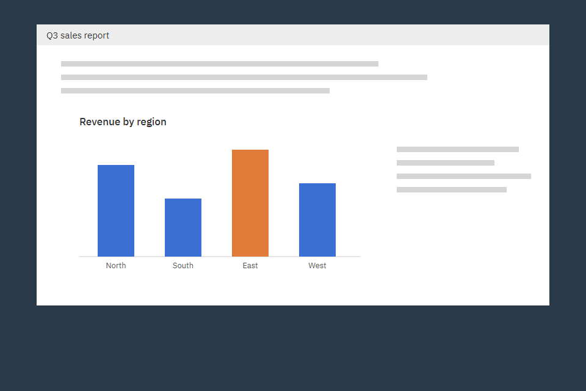
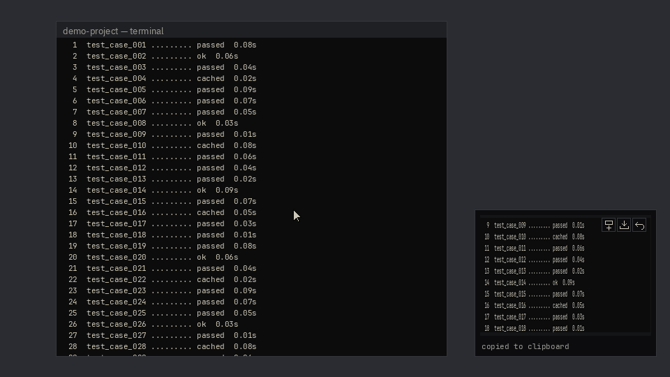

# Snapclick

**Press PrtSc, click two corners — the picture is in your clipboard.** A tiny Windows tray app.



## Download

**[Download Snapclick.exe](https://github.com/sa31300/snapclick/releases/latest/download/Snapclick.exe)** (Windows 10/11, no install, no Python needed)

The `.exe` is not code-signed, so Windows may show *"Windows protected your PC"* the first time. Click **More info → Run anyway**.

Some antivirus tools may flag Snapclick because it listens for the PrtSc key, reads the clipboard and screen, and (for long captures) passes the mouse wheel on to the window under it. The source code is open for review.

## How to use

1. Run `Snapclick.exe`. The icon appears in the tray (bottom-right, maybe under `^`).
2. Press **PrtSc** (or left-click the tray icon). The screen freezes and dims.
3. Click one corner, then the opposite corner. Paste anywhere with **Ctrl+V**.

**Esc** or **right-click** cancels. A magnifier next to the cursor helps you hit the exact pixel.
With the preview on, the thumbnail has these buttons:
- **Add below** (square with a plus): starts a long capture, see below.
- **Save** (arrow into tray, only when auto-save is off): saves this one capture to your save folder.
- **Retake** (back arrow): undoes the capture (clipboard and saved file) and lets you select again on the same frozen screen.

When a capture is saved, click the **file name** under the thumbnail to open it in File Explorer.

### Long captures (stack)

For things taller than the screen, like long terminal output. Snapclick joins several pieces into **one tall image**.



1. Take a normal capture of the first part (the preview must be on).
2. Click **Add below** on the preview. The screen stays live.
3. Scroll with the mouse wheel, then **click** where the next piece should end. Lines that scrolled past are included too.
4. Repeat, then finish with **✓** on the preview, **Esc** or **right-click**.

After every piece, the clipboard holds the whole joined image. **Retake** removes the last piece. With auto-save on, only the final image is saved.
If you scroll too fast (or drag the scrollbar), Snapclick shows *jumped too far*: scroll back to the striped part and go on.

> If PrtSc opens the Windows Snipping Tool instead, turn it off in
> *Settings → Accessibility → Keyboard → "Use the Print screen key to open screen capture"*.
> Other screenshot apps (Greenshot, ShareX, Lightshot) can also hold PrtSc — close them or change their hotkey.

## Settings

Right-click the tray icon → **Settings…**. Changes save instantly to `%APPDATA%\Snapclick\settings.json`.

| Setting | Default |
|---|---|
| Auto-save each capture | Off (in a long capture, only the final joined image is saved) |
| Save folder | `%USERPROFILE%\Pictures\Snapclick` |
| File name | `YYYY-MM-DD_HH-MM-SS.png` (adds `_2`, `_3` within the same second) |
| Format | PNG (or JPG) |
| Hotkey | PrtSc (fixed) |
| Show preview after capture | Off — a thumbnail appears bottom-right for 3 s (stays while the mouse is on it; Add below, Save and Retake buttons). Needed for long captures. |
| Start with Windows | Off |

## Known issues

- **Scrolling up fast can shift the stripes** in a long capture. In some windows (for example Claude Code), a fast swipe up can put the striped part a few lines off the captured text. Scroll a little down and back up: the stripes go back on the right lines.
- **Rare: lost lines after a half-drawn first scroll.** In apps that redraw their whole screen line by line, if the very first scroll of a long capture catches the screen half drawn, a few lines can be left out of the image. Check long captures from such apps before you share them.

## How I built this

I built Snapclick by **directing Claude Code** from a written spec: [`docs/SPEC.md`](docs/SPEC.md). I wrote what the app must do and how it must look; the AI wrote the code in small, tested steps (see the commit history). When I wanted a new feature (the magnifier), it went into the spec first.

Key decisions and why:

- **Python + PySide6 (Qt)** — one toolkit for the tray, the overlay and the settings window; looks the same on every PC.
- **Freeze first, then select** — the screen is captured the moment you press PrtSc, so menus and tooltips don't vanish while you aim.
- **All math in real pixels** — correct on 125%/150% scaled screens and across two monitors with different scaling. Lines are drawn in real pixels too, so they stay sharp.
- **Win32 `RegisterHotKey`** — a global PrtSc hotkey without admin rights or a keyboard hook.
- **Settings save instantly, no Save button** — fewer clicks, nothing to forget.
- **Fonts bundled** (JetBrains Mono, IBM Plex Sans, both OFL) — the design looks the same even if they aren't installed.
- **One `.exe` with PyInstaller** — download and run, nothing to install.

For the long captures (stack) the spec said: **spike first**. A small test tool checked the two risky parts on real terminals before anything else was built. Then:

- **The screen stays live; Snapclick reads the frame up to 25 times a second** and keeps a hidden long image of everything that scrolled through it. That is why lines that already left the screen still end up in the picture.
- **Matching by column blocks, then whole rows** — 8 blocks per pixel row find the scroll position even with a scrollbar in the frame; requiring whole rows to match stops look-alike lines (logs that differ only in a number) from matching at the wrong place.
- **Ignore what does not scroll** — title bar, padding and a strip of the window behind are found on the first scroll and left out.
- **No keyboard or mouse hooks** — the wheel is passed on with a normal window message, and Esc while stacking is a hotkey, like PrtSc.
- **Tested end to end** — scripts drove real terminals (classic console and Windows Terminal) with real wheel input, then checked the joined image line by line: every line exactly once.

### Build from source

Use Python 3.12 from [python.org](https://www.python.org/) (Anaconda's Python is too old for Qt 6.12).

```
py -3.12 -m venv .venv
.venv\Scripts\pip install -r requirements.txt -r requirements-dev.txt
.venv\Scripts\python -m snapclick       # run
.venv\Scripts\python -m unittest discover tests   # tests
.venv\Scripts\python build.py           # make dist\Snapclick.exe
.venv\Scripts\python tools\make_demo_gif.py   # remake docs/demo.gif and docs/stack.gif
```

## License

[MIT](LICENSE). Bundled fonts: SIL Open Font License (see `snapclick/fonts/`).
