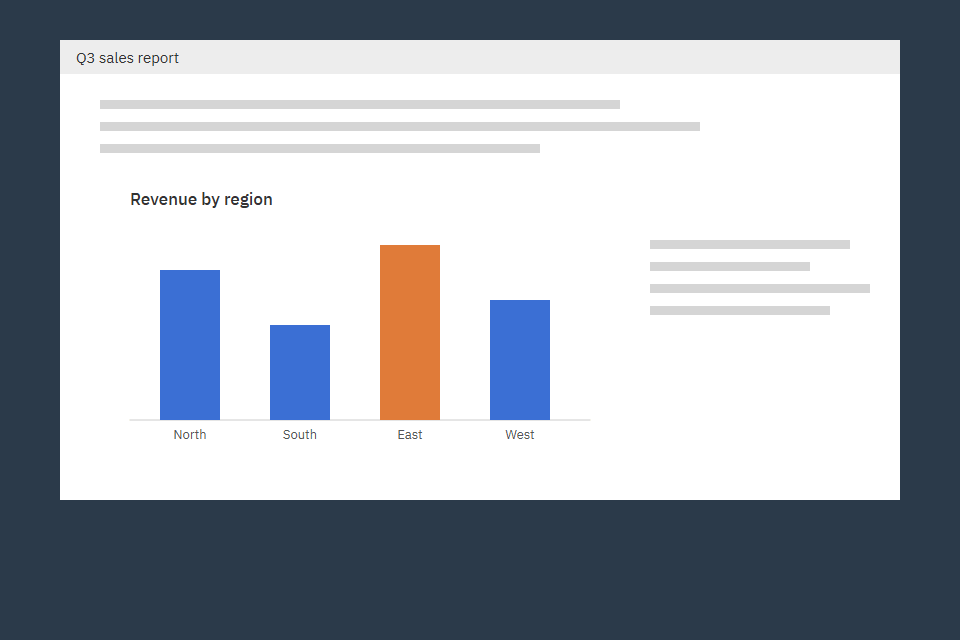
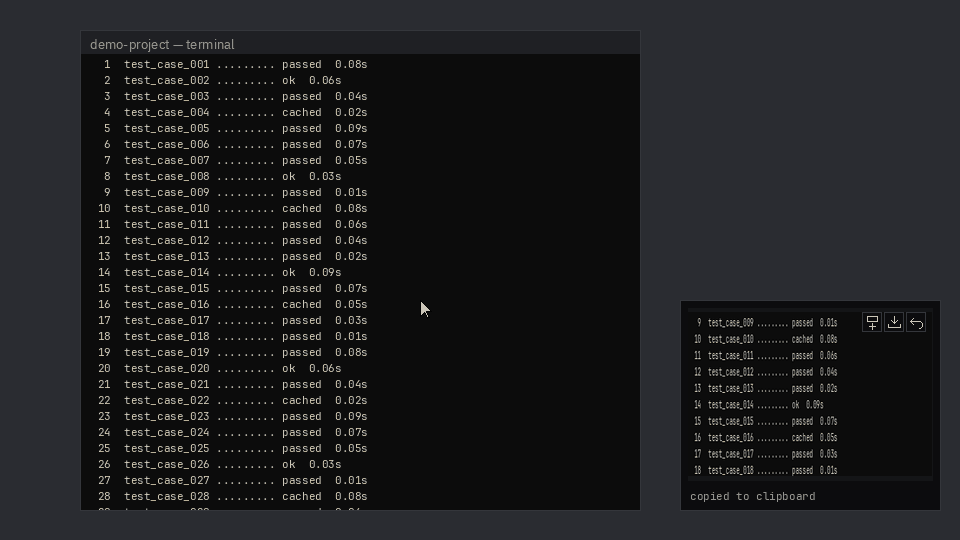
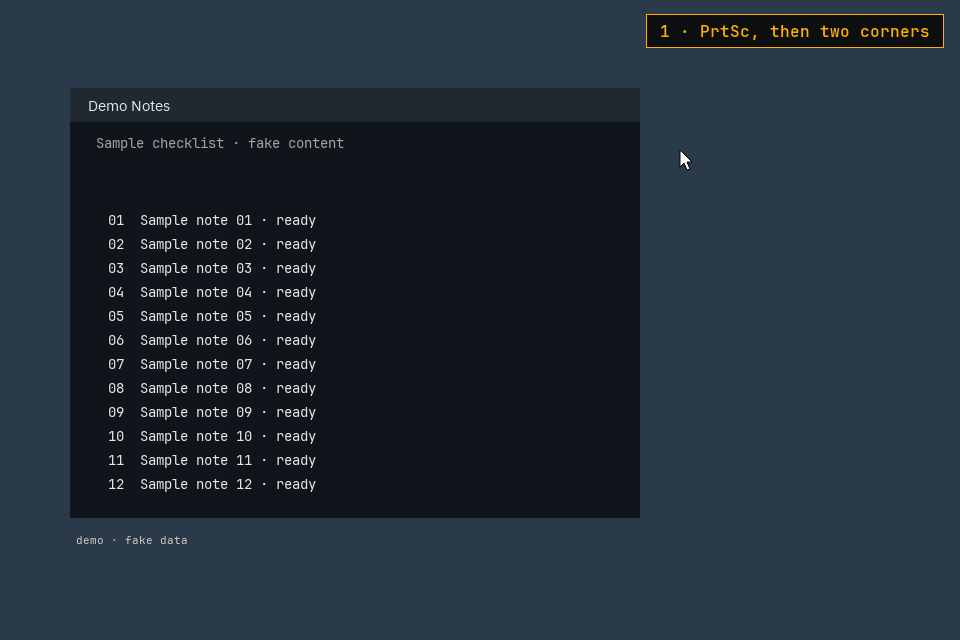
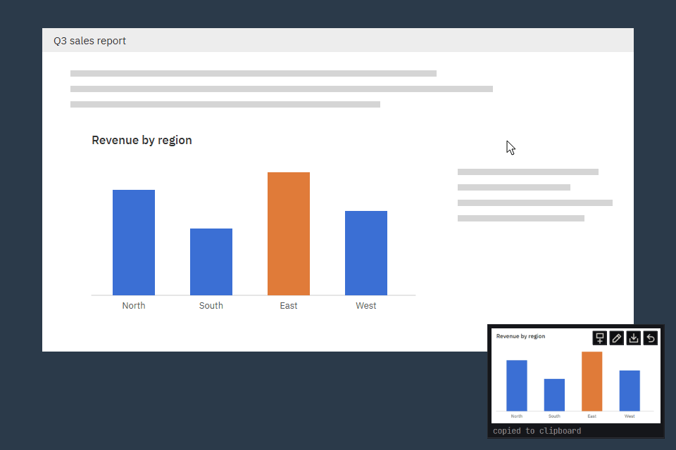
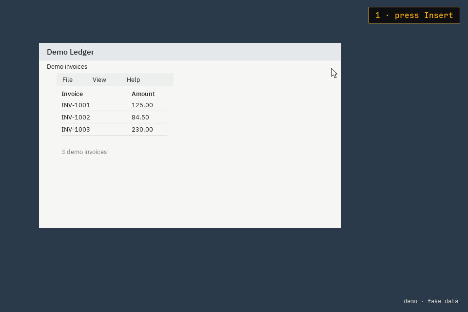

# Snapclick

**Press PrtSc, click two corners — the picture is in your clipboard.** A tiny Windows tray app.



## Download

**[Download Snapclick.exe](https://github.com/sa31300/snapclick/releases/latest/download/Snapclick.exe)** (Windows 10/11, no install, no Python needed)

Recording and Repeat area are available in [source builds](#build-from-source); they are not in the published release yet.

The `.exe` is not code-signed, so Windows may show *"Windows protected your PC"* the first time. Click **More info → Run anyway**.

Some antivirus tools may flag Snapclick because it listens for the PrtSc key, reads the clipboard and screen, and (for long captures) passes the mouse wheel on to the window under it. The source code is open for review.

## How to use

1. Run `Snapclick.exe`. The icon appears in the tray (bottom-right, maybe under `^`).
2. Press **PrtSc** (or left-click the tray icon). The screen freezes and dims.
3. Click one corner, then the opposite corner. Paste anywhere with **Ctrl+V**.

**Esc** or **right-click** cancels. A magnifier next to the cursor helps you hit the exact pixel.
With the preview on, the thumbnail has these buttons:

- **Add below** (square with a plus): starts a long capture, see below.
- **Repeat area** (two overlapping rectangles): keeps the box fixed so PrtSc can add more full images, see below.
- **Draw** (pen): mark up the picture before you paste it, see below.
- **Save** (arrow into tray, only when auto-save is off): saves this one capture to your save folder.
- **Retake** (back arrow): undoes the capture (clipboard and saved file) and lets you select again on the same frozen screen.

When a capture is saved, click the **file name** under the thumbnail to open it in File Explorer.

### Long captures (stack)

For things taller than the screen, like long terminal output. Snapclick joins several pieces into **one tall image**.



1. Take a normal capture of the first part (the preview must be on).
2. Click **Add below** on the preview. The screen stays live.
3. Scroll with the mouse wheel or touchpad (in browsers like Brave or Chrome, press **↓** instead), then **click** where the next piece should end. Lines that scrolled past are included too.
4. Repeat, then finish with **✓** on the preview, **Esc** or **right-click**.

After every piece, the clipboard holds the whole joined image. **Retake** removes the last piece. With auto-save on, only the final image is saved.
If you scroll too fast (or drag the scrollbar), Snapclick shows *jumped too far*: scroll back to the striped part and go on.

### Repeat area (fixed rectangle)

Capture the same box again while you scroll and work normally. Requires a source build and **Show preview after capture** on.



1. Press **PrtSc**, click two corners, then click **Repeat area** on the preview. A dashed amber box stays over the live screen.
2. Scroll up or down, then press **PrtSc** again. Each press adds the whole box below the previous images. Clicking and typing still work normally.
3. Finish with **Esc** or **✓** on the preview, then paste with **Ctrl+V**. **Draw** and **Save** work on the joined image.

The soft amber strips help you line up the next capture: the last image's **bottom lines appear above** the box, and its **top lines appear below**. They stay still until the next capture and are left out of the result.

**Whole images stay in capture order, including repeated lines.** Scrolling up still adds below. Content skipped between keypresses is not recovered.

While adding, **Retake** removes only the last image. With just image 1 left, it selects again on the original frozen screen. After finishing, Retake undoes the joined capture. It preserves anything newer you copied.

With **Auto-save screenshots** on, only the final joined image is kept, in PNG or JPG. With it off, use **Save** on the finished preview.

### Draw on a capture

Point at something before you share it: arrows, boxes, highlights, notes, blur and numbered steps.



1. With the preview on, click **Draw** (pen) on the thumbnail. The captured picture opens in its own window.
2. Pick a tool: **arrow**, **box**, **mark** (yellow highlight), **text**, **blur** (big square pixels, so text can't be read back) or **step** (1, 2, 3…). Pick a color: red, blue or green. **Undo** removes the last one.
3. Click **✓ done** or press **Enter**. The clipboard now holds the picture with your drawings. **Esc** closes without changes.

Works after a long capture, Repeat area or on a recording's PNG sheet too: scroll inside the window to draw on the whole picture. If the capture was already saved, the file gets the drawings too. Click **Draw** again to change them.

### Record a short flow

Show a sequence of actions in one image: Snapclick turns a short screen recording into a **numbered PNG frame sheet**, ready to paste into an AI chat. Recording currently needs a source build. **PNG only for now; MP4 is planned.**



1. Press **Insert** (or right-click the tray icon → **Record**) and click two corners of the area.
2. Click **▶ record**, work inside the area, then click **■ stop** or press **Esc**. The timer stops automatically at the maximum length.
3. Paste the PNG sheet with **Ctrl+V** into an AI chat, Paint or Word.

The sheet has four columns, numbered frames and times. It skips unchanged frames and keeps the first and last moments. The pointer is included; a brief amber circle marks a detected left click. Only the selected area is recorded, with no sound.

With **Show preview after capture** on, the thumbnail offers **Draw**, **Save** (when Auto-save recordings is off) and **Retake**. Hover over it to keep it open. **Retake** deletes the saved recording sheet, restores the previous clipboard if nothing newer was copied, and starts a new recording selection.

**Auto-save recordings** is separate from screenshots and starts off. When on, the sheet is saved in the save folder as `rec_YYYY-MM-DD_HH-MM-SS.png`. With it off, the sheet goes to the clipboard; use the preview's Save button to save it. Recordings always use PNG, even when screenshot format is JPG.

While Snapclick runs, **Insert** is reserved for recording and no longer toggles overwrite mode in other apps. If another app holds Insert, Snapclick explains this once; Record still works from the tray menu.

> If PrtSc opens the Windows Snipping Tool instead, turn it off in
> *Settings → Accessibility → Keyboard → "Use the Print screen key to open screen capture"*.
> Other screenshot apps (Greenshot, ShareX, Lightshot) can also hold PrtSc — close them or change their hotkey.

## Settings

Right-click the tray icon → **Settings…**. Changes save instantly to `%APPDATA%\Snapclick\settings.json`.

| Setting | Default |
|---|---|
| Auto-save screenshots | Off (in a long capture or Repeat area, only the final joined image is kept) |
| Save folder | `%USERPROFILE%\Pictures\Snapclick` |
| File name | `YYYY-MM-DD_HH-MM-SS.png` (adds `_2`, `_3` within the same second) |
| Format | PNG (or JPG) for screenshots; recording sheets stay PNG |
| Hotkey · screenshot | PrtSc (fixed) |
| Hotkey · recording | Insert (fixed) |
| Show preview after capture | Off — a thumbnail appears bottom-right for 3 s and stays while hovered. Needed for long captures, Repeat area, and Draw, Save and Retake after a recording. |
| Start with Windows | Off |
| Frames per sheet | 12 (choose 8, 12 or 16; fewer when fewer frames changed) |
| Max recording length | 30 s (choose 15, 30 or 60 s) |
| Auto-save recordings | Off — separate from screenshot auto-save |

## Known issues

- **Scrolling up fast can shift the stripes** in a long capture. In some windows (for example Claude Code), a fast swipe up can put the striped part a few lines off the captured text. Scroll a little down and back up: the stripes go back on the right lines.
- **Draw doesn't scroll while you drag.** To mark something bigger than the draw window, scroll first, then draw.
- **Rare: lost lines after a half-drawn first scroll.** In apps that redraw their whole screen line by line, if the very first scroll of a long capture catches the screen half drawn, a few lines can be left out of the image. Check long captures from such apps before you share them.

## How I built this

I built Snapclick by **directing Claude Code** from a written spec: [`docs/SPEC.md`](docs/SPEC.md). I wrote what the app must do and how it must look; the AI wrote the code in small, tested steps (see the commit history). When I wanted a new feature (the magnifier), it went into the spec first.

Key decisions and why:

- **Python + PySide6 (Qt)** — one toolkit for the tray, the overlay and the settings window; looks the same on every PC.
- **Freeze first, then select** — the screen is captured the moment you press PrtSc, so menus and tooltips don't vanish while you aim.
- **All math in real pixels** — correct on 125%/150% scaled screens and across two monitors with different scaling. Lines are drawn in real pixels too, so they stay sharp.
- **Win32 `RegisterHotKey`** — global PrtSc and Insert hotkeys without admin rights or a keyboard hook.
- **Settings save instantly, no Save button** — fewer clicks, nothing to forget.
- **Fonts bundled** (JetBrains Mono, IBM Plex Sans, both OFL) — the design looks the same even if they aren't installed.
- **One `.exe` with PyInstaller** — download and run, nothing to install.

For the long captures (stack) the spec said: **spike first**. A small test tool checked the two risky parts on real terminals before anything else was built. Then:

- **The screen stays live; Snapclick reads the frame up to 25 times a second** and keeps a hidden long image of everything that scrolled through it. That is why lines that already left the screen still end up in the picture.
- **Matching by column blocks, then whole rows** — 8 blocks per pixel row find the scroll position even with a scrollbar in the frame; requiring whole rows to match stops look-alike lines (logs that differ only in a number) from matching at the wrong place.
- **Ignore what does not scroll** — title bar, padding and a strip of the window behind are found on the first scroll and left out.
- **No keyboard or mouse hooks** — the wheel is passed on with a normal window message, and Esc while stacking is a hotkey, like PrtSc.
- **↓ for browsers** — in Brave, touchpad scrolling never reached the overlay, and the browser ignored a passed-on wheel message. So ↓ (a hotkey while stacking) sends one real wheel notch at the first piece, while the overlay lets the mouse through for that moment.
- **Tested end to end** — scripts drove real terminals (classic console and Windows Terminal) with real wheel input, then checked the joined image line by line: every line exactly once.

For **Draw**, a mockup GIF came first ([`docs/design/annotations-flow.gif`](docs/design/annotations-flow.gif)); open questions were decided in the spec before any code. Then:

- **Drawings stay a list of shapes** until you paste — so undo works, and Draw again can still change them. They are painted onto the picture in real pixels only at the end.
- **Blur is big square pixels**, not a soft blur: each square is the average color under it, so text can't be read back.

For **Record**, the approved [spec and reference GIF](docs/SPEC.md#2d-record--short-screen-recordings) came first. The PNG flow was then built in separate steps, tested by the owner on their PC:

- **PNG sheets first** — one image can show an AI chat the sequence; MP4 can be added later without delaying this flow.
- **About 5 frames per second, then skip duplicates and choose evenly** — keep the first and last moments and limit the sheet to 2400 px on its longest side. Frames are kept at sheet resolution to limit memory use.
- **Pointer and click circles without mouse hooks** — the left button is polled only while recording. Click marks were a separate step, tested with Bitdefender on.
- **Separate recording auto-save** — turning it on never changes the screenshot setting. Draw and Retake reuse the capture workflow.

For **Repeat area**, the [written spec](docs/SPEC.md#2e-repeat-area--full-captures-of-one-fixed-rectangle) came first, followed by small steps tested by the owner on their PC:

- **Read only on PrtSc** — no scroll tracking or matching. Full images are appended in capture order, with repeated content kept.
- **Small static references** — the last image's edges are shown in the existing border windows, with a soft amber tint chosen from three previews. They use already captured pixels.
- **Reuse screenshot saving, Draw and safe Retake** — one final PNG/JPG file, editable drawings, and no overwriting a newer clipboard copy when undoing.

### Build from source

Use Python 3.12 from [python.org](https://www.python.org/) (Anaconda's Python is too old for Qt 6.12).

```
py -3.12 -m venv .venv
.venv\Scripts\pip install -r requirements.txt -r requirements-dev.txt
.venv\Scripts\python -m snapclick       # run
.venv\Scripts\python -m unittest discover tests   # tests
.venv\Scripts\python build.py           # make dist\Snapclick.exe
.venv\Scripts\python tools\make_demo_gif.py   # remake docs/demo.gif, docs/stack.gif and docs/draw.gif
.venv\Scripts\python tools\make_record_gif.py # remake docs/record.gif (fake content only)
.venv\Scripts\python tools\make_repeat_gif.py # remake docs/repeat.gif (fake content only)
```

## License

[MIT](LICENSE). Bundled fonts: SIL Open Font License (see `snapclick/fonts/`).
